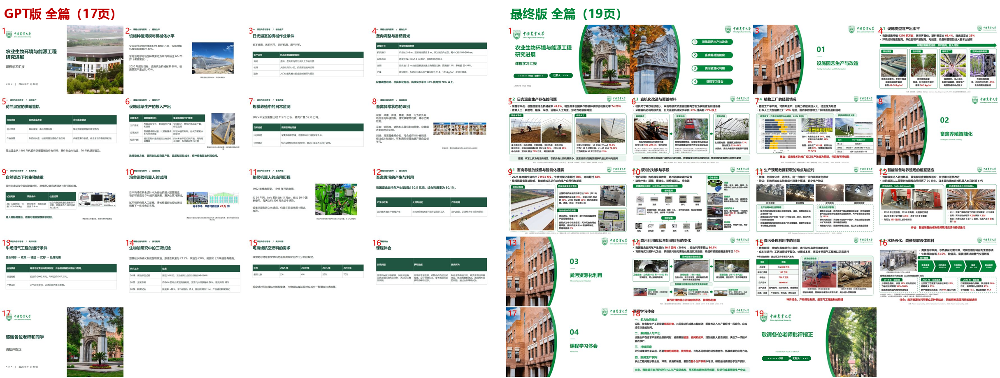
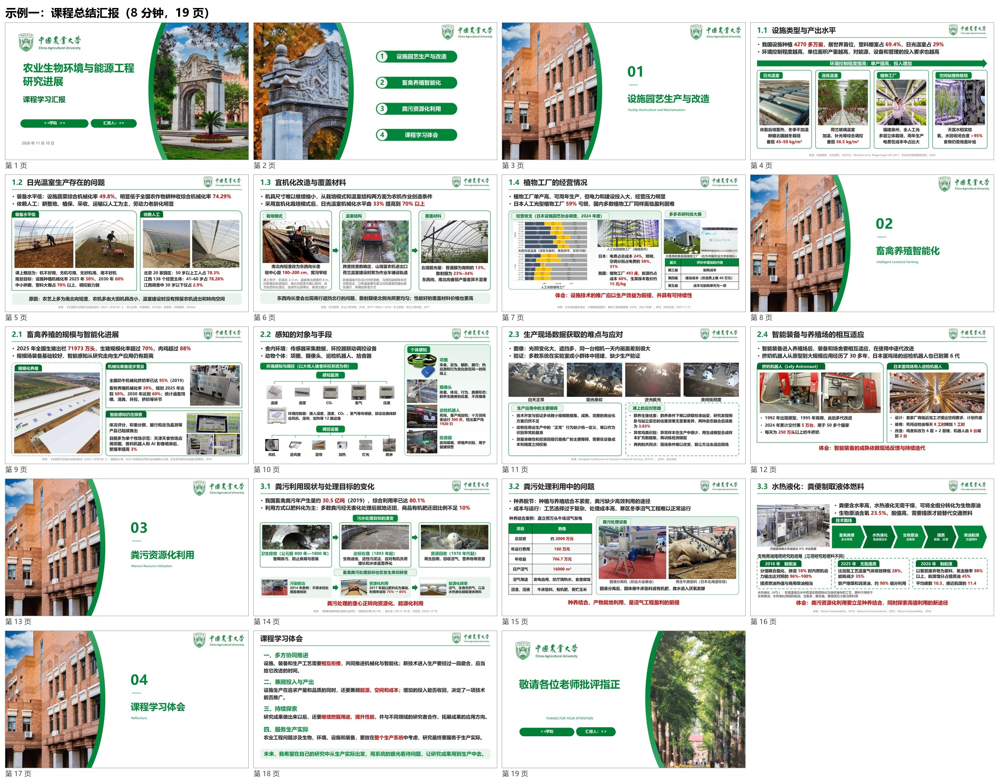
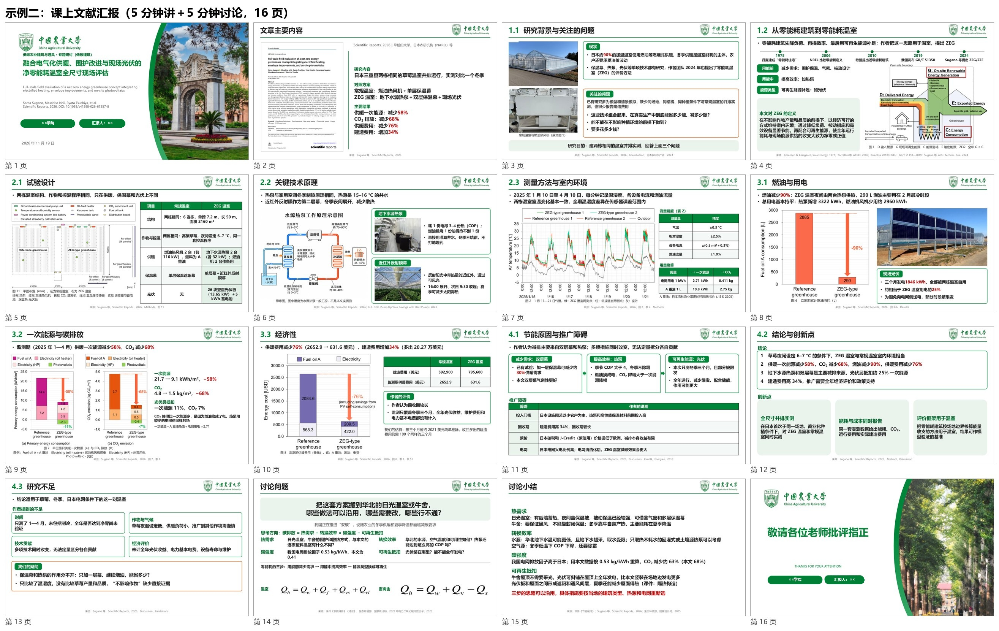

# ai-report-ppt：用 AI 做汇报 PPT



左边是 AI 直接生成的课程汇报，右边是最终交付的版本：同一门课，同一批材料。这套 skill 把我们做汇报时用过的流程和细节整理下来，帮助 AI 按你的内容和审美做 PPT。

适合大学生、研究生做课程汇报、文献汇报和项目作业汇报。你负责判断讲什么、哪些内容重要；AI 帮你整理文稿、制作页面和检查版式。

这套方法来自课程总结和文献汇报两次实践，期间用到 Codex 和本地 Claude，后来打包成 Codex skill；打包后的 skill 尚未完整跑通一次新汇报，欢迎试用并反馈。

## 安装

将本仓库下载或克隆到 Codex 的 skills 目录，文件夹名保留为 `ai-report-ppt`：

```text
C:\Users\你的用户名\.codex\skills\ai-report-ppt\SKILL.md
```

安装依赖：`pip install python-pptx pillow numpy pymupdf`。渲染检查需要 Windows 和 PowerPoint。准备学校或课题组模板，以及一份你认可的成品 PPT 作视觉参照；也可以先看下方案例的总览图。

Claude Code 用户也可以让 Claude 读取整个文件夹中的 `SKILL.md` 和引用文件；该安装方式尚未完整验证。

## 怎么开口

```text
用 ai-report-ppt 帮我做一份汇报 PPT。
类型：课程总结汇报；时长：8 分钟；听众：同专业研究生，评委是任课老师。
老师要求原话：（粘贴）
模板：D:\…\学校模板.pptx
参照成品：D:\…\我认可的PPT.pptx
素材：D:\…\素材文件夹
先看参照、写场景卡，缺的信息一次问我一个。
```

也可以只让 AI 统计一份参照的样式、按样式表重排现有 PPT，或渲染检查已有页面。

## 为什么这样设计

做汇报时遇到三个常见问题，我们这样处理：

| 毛病 | 表现 | 补法 |
|---|---|---|
| 记不住已经定下的东西 | 越改越偏，改好的地方又被改回去 | 定下来的事写成文件：场景卡、逐页文稿、样式表、个人偏好 |
| 没有你的审美，只有模型默认的审美 | 大数字色块、细线条、三栏卡片、装饰图标，一眼就是 AI | 照着你认可的成品做，学校模板只取外壳 |
| 看不见自己做出来的页面 | 第一版大片空白、框底空行、文字溢出 | 每次生成后渲染成图，自己先查一轮再给你看 |

分工：讲什么、什么重要、删什么，你来判断；排版、对齐、找图、复制粘贴、检查，交给 AI。缺资料时 AI 会写好检索提示词让你去查，不硬做。

## 文件夹里有什么

| 位置 | 管什么 |
|---|---|
| `SKILL.md` | AI 的入口：六条原则、四个阶段九步、怎么和你配合 |
| `流程/1_想清楚.md` | 讲什么：场景、两类汇报的区别、选文、搭架构、页数、讨论问题页 |
| `流程/2_写内容.md` | 写什么：查资料、逐页文稿、取舍重点、屏上文字 |
| `流程/3_做页面.md` | 长什么样：参照和样式表、版式和图片规则、检查、第一版常见毛病 |
| `流程/4_交付与积累.md` | 收尾：备注、交付清单、改动审查、怎么把纠正记下来 |
| `可调设置/` | 默认样式表（我们的设计，可改）和你的个人偏好（空着，用的时候让 AI 记） |
| `写作规范/` | 去 AI 味写作规范（前八节可以整段贴给任何 AI）和防御性写作终审 |
| `examples/` | 两份真实汇报：成品总览图、第一版与最终版对比、当时的 md 文稿、生成脚本 |
| `scripts/` | 生成函数库、渲染、导出 PDF、压缩；`extract_style.py`（统计参照样式）、`check_deck.py`（自动检查）、`make_sheet.py`（总览拼图）是把我们手工做过的步骤写成的脚本，在两份成品上测过，还没在新汇报里实际用过 |


## 两个案例

[课程总结汇报](examples/01_课程总结汇报/)：8 分钟、19 页，展示从架构、文字稿到页面的过程。



[课上文献汇报](examples/02_课上文献汇报/)：5 分钟讲解、5 分钟讨论，展示一篇论文的汇报制作过程。



案例中不附 PPT 文件；脚本引用的母版请换成你自己的。详见 [案例说明](examples/README.md)。

## 反馈与更新

欢迎通过 GitHub Issues 分享使用体验或提出问题。后续会根据新的汇报实践和反馈更新，记录见 [CHANGELOG](CHANGELOG.md)。


## 使用与转载

本仓库的脚本采用 [MIT 许可证](LICENSE)；文字内容转载时请注明出处。案例图片中的第三方素材及学校标识不在脚本许可范围内。
